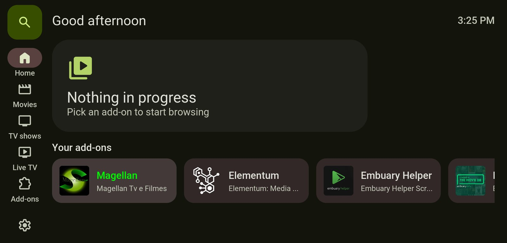
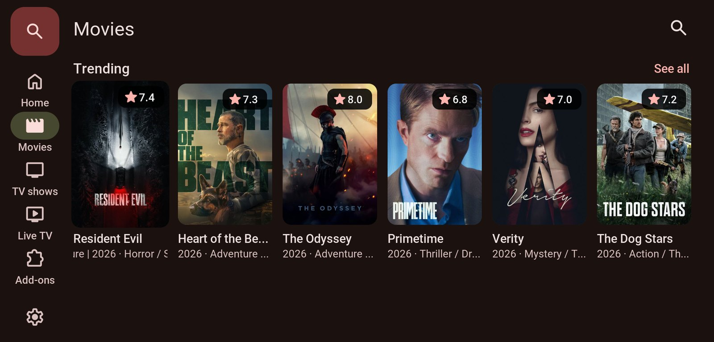
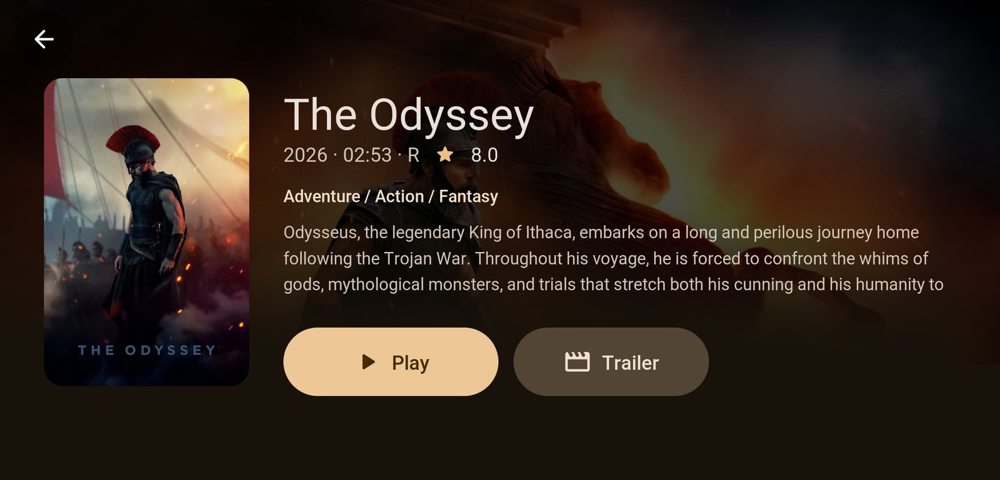
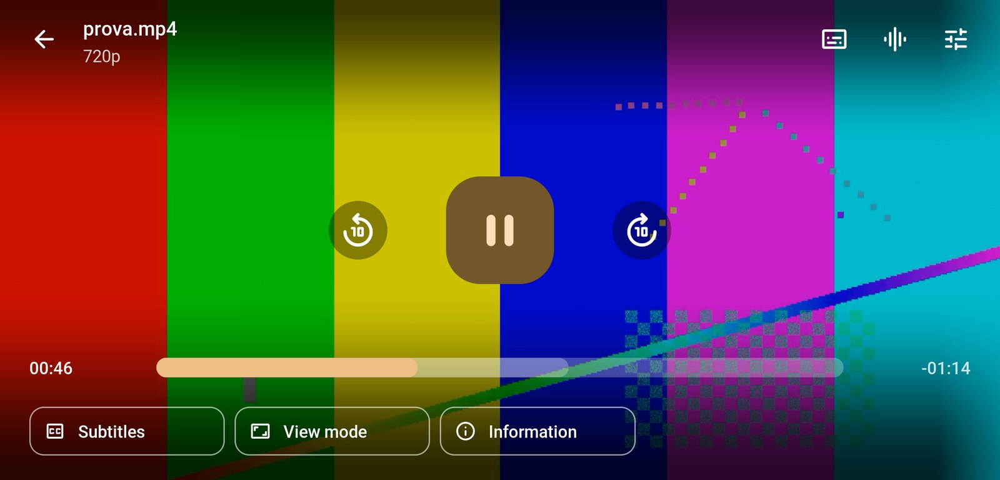
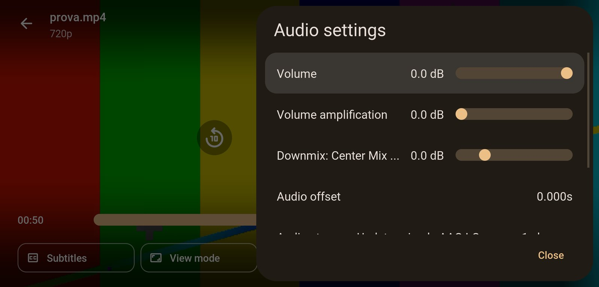

# Tinta

A Kodi 21 (Omega) skin for Android phones in landscape, built on Material 3 (Material You). It is designed for
touch first: 48 dp targets, a navigation rail, side sheets instead of centred pop-ups. Its colours are not fixed.
A companion service extracts a seed colour from the artwork of the focused item and publishes a full Material 3
dark scheme, so the interface takes on the tone of the film, show or add-on in focus.



| | |
| --- | --- |
| Skin id | `skin.tinta` |
| Companion add-on | `script.tinta.colors`: colour service and content slots (required by the skin) |
| Kodi | 21 Omega, `xbmc.gui` 5.17.0 |
| Target | Android phones in landscape, about 20:9; layout tuned on 2251 × 1080 at ~460 dpi |
| Languages | English, Italian |
| License | Apache-2.0 (code); Roboto OFL-1.1, Material Symbols Apache-2.0 |

## Screens

| Movies page (rows from an add-on) | Detail |
| --- | --- |
|  |  |

| Player controls | Player settings as a side sheet |
| --- | --- |
|  |  |

## Features

- **Navigation rail**: search FAB, Home, Movies, TV shows, Live TV, Add-ons, settings. The entry of the current
  section shows the M3 active indicator.
- **Home**: a carousel of library items in progress (smart playlists for movies and episodes) and the list of
  installed video add-ons.
- **Movies and TV shows pages**: up to four rows of posters each, fed by folders of any video add-on (see
  *Content slots*).
- **Live TV** and the **search** button: open a folder of any add-on, chosen the same way.
- **Media views**: posters (movies, shows, seasons, sets, videos) or list (folders and everything else), with a
  toggle in the top bar that is remembered as a skin setting.
- **Player**: touch OSD with a 16 dp seek track (played part, cache, draggable), ±10 s, subtitle/audio/video
  sheets, view mode and player information.
- **Dialogs**: confirmation, select (side sheet, also used by add-ons to choose a source), context menu,
  keyboard, numeric pad, notifications as snackbars, background progress, settings pages, add-on settings and
  information, file manager and media sources, file browser.

## Content slots

The skin does not depend on any particular add-on. Its content comes from ten slots, each holding one add-on
folder: Movies rows 1–4, TV shows rows 1–4, Live TV and Search. A slot is filled from the context menu: a long
press on a folder of any video add-on shows **Use in Tinta…**, which lists the slots with their current content.
*Settings › Appearance* shows every slot and opens or clears it.

| Slot | Shown as | Empty |
| --- | --- | --- |
| `movies.1` … `movies.4` | Rows of the Movies page, titled with the folder label, *See all* opens the folder | Row hidden; a page with no rows explains how to add one |
| `shows.1` … `shows.4` | Rows of the TV shows page | As above |
| `live` | Live TV entry of the rail | The entry explains how to assign a folder |
| `search` | Search button of the rail | The button opens the list of video add-ons |

A slot is stored as `Skin.String(tinta.<slot>.path)` and `Skin.String(tinta.<slot>.label)`; the label is the
folder label without Kodi formatting tags. Rows load their folder like any Kodi container, so a slow add-on only
delays its own row.

## Dynamic colour

```
focused item artwork ──► script.tinta.colors ──► Window(Home).Property(Tinta.<Role>) ──► $VAR[c_<role>] ──► controls
```

The service polls every 120 ms and resolves the artwork in this order: `Window(Home).Property(Tinta.Source)` when
a window sets it; the playing item when the video OSD or info is open; the focused container
(`System.CurrentControlId`, poster → tvshow.poster → thumb → fanart → icon); the `ListItem` of the active
window or dialog. When nothing is found the last scheme stays.

| Step | Detail |
| --- | --- |
| Image | Kodi texture cache (`special://thumbnails`) when the artwork has already been shown, otherwise read from its URL through `xbmcvfs` |
| Quantisation | PIL `quantize(16, MAXCOVERAGE)` on a 96 px thumbnail |
| Seed | Highest score among clusters with ≥ 1 % of the pixels and CIE chroma ≥ 12: `0.7 · C/100 + 0.3 · min(4 · share, 1)`; a grey image keeps the hue of its largest cluster at chroma ≤ 16 |
| Palettes | Primary at the seed hue, chroma clamped to 32–56; secondary at a third of it; tertiary at hue + 60° and half the chroma; neutral 5; neutral variant 9 |
| Tones | Material 3 dark tones (primary 80, on-primary 20, container 30, surface 6, containers 4/10/12/17/22, …), with tone = CIE L\*; chroma is reduced by bisection until the colour fits sRGB |
| Output | 28 roles as `AARRGGBB` properties plus `Tinta.Seed` and `Tinta.Ready`; a scheme change fades in 6 steps of 30 ms |
| Cache | 400 artworks (LRU) |

Tone = L\* in CIE LCh is an approximation of HCT, which uses CAM16; for the M3 baseline seed `#6750A4` it gives a
primary of `#D2BBFF` against `#D0BCFF` from the reference implementation. Every colour variable in the skin falls
back to the baseline scheme when the service has not published yet. *Settings › Appearance › Always use base
colours* keeps the baseline scheme.

## Layout

Coordinates are skin pixels on a 1080 px high canvas, with 1 dp = 2.75 px (a 1080 px high phone screen at
~460 dpi), and the M3 type scale is converted the same way (body large 16 sp → 44 px). Windows anchor to both
edges, so widths follow the screen, but list item layouts in Kodi have a fixed width: list rows are 1964 px wide,
the width left by the rail on a 2251 px wide window. On narrower screens the right-hand part of a row is cut.

Rounded shapes are white 9-slice textures tinted with `colordiffuse`; images are rounded with diffuse masks.
Icons are Material Symbols Rounded, instanced to outline and filled static fonts and subset to the glyphs in use.

## Requirements

- Kodi 21 Omega on Android (it also runs on other platforms; the layout is only tuned for phones).
- `script.module.pil`, shipped with Kodi.
- Any video add-on for the content slots; none is required.

## Installation

1. Build the zips (see *Development*) or take them from a release.
2. In Kodi: *Settings › Add-ons › Install from zip file*, first `script.tinta.colors.zip`, then `skin.tinta.zip`.
3. Accept the switch to the new skin.

## Development

```
tools/fetch_fonts.sh                                # source fonts into third_party/fonts
python3 tools/gen_assets.py third_party/fonts skin.tinta   # textures, fonts, icon table
python3 tools/gen_colors.py                         # colors/defaults.xml and the c_<role> variables
python3 tools/gen_pages.py                          # Movies/TV shows pages and slot settings
python3 tools/build.py                              # build/<id>.zip with static checks
ADB=/path/to/adb python3 tools/deploy.py --shot s.png   # install on a phone and take a screenshot
```

`build.py` replaces the `{ic:name}` placeholders in the XML with Material Symbols glyphs and fails on unknown
icons, malformed XML, and `$VAR`, `$EXP` or includes that are not defined.

`deploy.py` copies the zips to `/sdcard/Download/tinta` over adb, creates the `.dev` marker there and sends
`JSONRPC.NotifyAll("tinta", "deploy")` through `adb forward tcp:9090`. The colour service handles that
notification only when the marker exists: it extracts the zips into the add-on folder and reloads the skin, which
avoids writing to `Android/data` (not writable over adb on recent Android). Kodi needs *Allow remote control from
applications on this system* enabled for JSON-RPC on port 9090.

| Tool | Purpose |
| --- | --- |
| `kodirpc.py` | Minimal JSON-RPC client over TCP |
| `listmenu.py` | Labels and paths of the list on screen, read from info labels without calling the plug-in |
| `rangeserver.py` | Static HTTP server with `Range` support, to play test videos through `adb reverse` |

## Known limitations

- Only video windows are styled: music, pictures, PVR, games, profiles and weather use no skin XML and do not
  open.
- List rows are 1964 px wide (see *Layout*).
- Kodi registers the *Use in Tinta…* context entry when the add-on is installed or enabled; after a manual
  copy of the files it appears after a restart.

## Credits

Fonts: [Roboto](https://github.com/googlefonts/roboto-classic) (SIL OFL 1.1) and
[Material Symbols](https://github.com/google/material-design-icons) (Apache 2.0); their licenses are in
`skin.tinta/fonts`. Control ids follow the Kodi core sources and Estuary.
